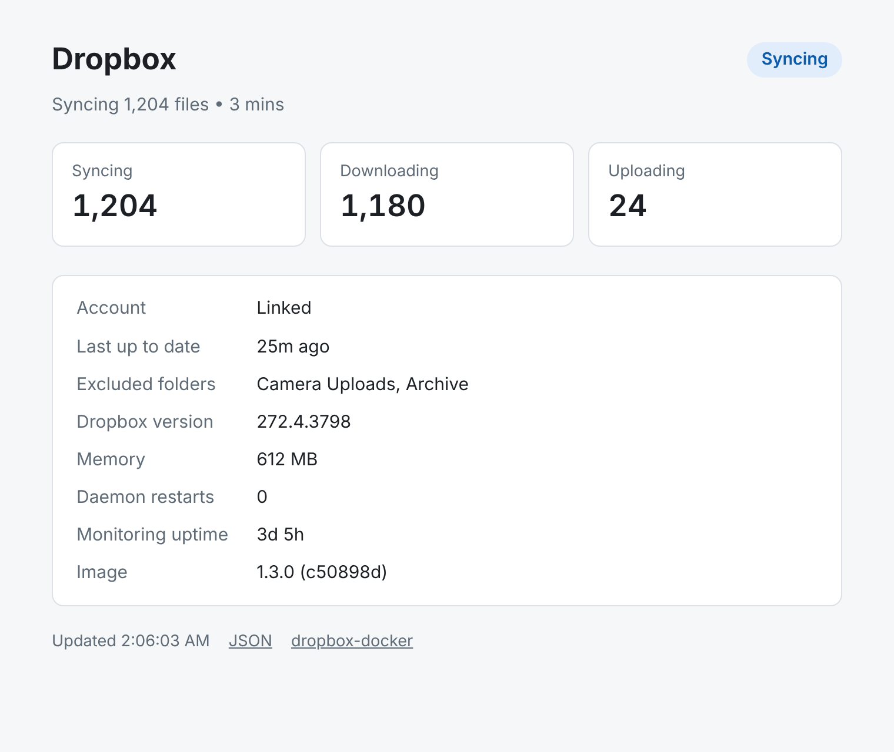
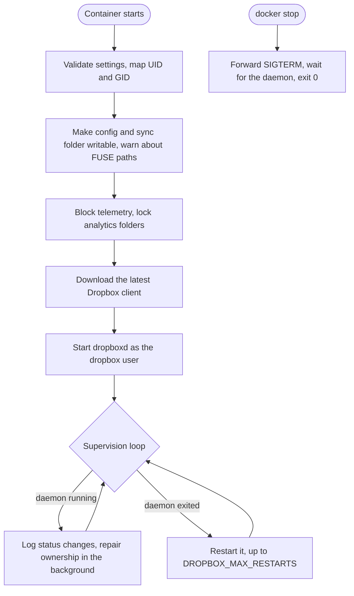

# dropbox-docker

[](https://github.com/islamdiaa/dropbox-docker/actions/workflows/ci.yml)
[](https://github.com/islamdiaa/dropbox-docker/releases)
[](https://hub.docker.com/r/islamdiaa/dropbox-docker)
[](https://hub.docker.com/r/islamdiaa/dropbox-docker)
[](https://scorecard.dev/viewer/?uri=github.com/islamdiaa/dropbox-docker)
[](LICENSE.md)

Run the official Dropbox client on your server, NAS or homelab, in Docker. It's built for unattended use, including accounts with a million files or more: it supervises and restarts the daemon, shuts down cleanly, fixes the permission problems that usually stop Dropbox from syncing in a container, and tells you in plain words when something is wrong.

<picture>
  <source media="(prefers-color-scheme: dark)" srcset="docs/images/status-page-dark.png">
  
</picture>

## Features

- **Always the current Dropbox client.** The official daemon is downloaded on every start, so it never falls behind.
- **Supervised.** If the daemon crashes it's restarted, up to a limit. `docker stop` shuts it down cleanly in about a second.
- **Status page and metrics.** A web page (shown above), a JSON API and Prometheus metrics.
- **Permissions handled.** The sync folder is made writable for the Dropbox user. Files that other users drop into it (root over SSH, scripts) are fixed so they sync, or left alone on shared NAS setups (`OWNERSHIP_FIX_MODE`).
- **Telemetry crash fix.** The daemon has a known Rust panic in its analytics code that crashes it while indexing large accounts. The container blocks the telemetry endpoint and locks the analytics folders, so it can't happen.
- **Clear diagnostics.** The log says when the sync folder isn't writable, when a path is on a filesystem Dropbox doesn't support (Unraid's `/mnt/user`), and where each linked account actually syncs to.
- **Least privilege.** The daemon runs as an unprivileged user, and the container works with `cap_drop: ALL` plus five capabilities.
- **Tested.** Unit and end-to-end tests run on every change, and every image is scanned for vulnerabilities before it's published.

## Quick start

### Unraid

1. Download the template to your flash drive (Unraid terminal):
   ```bash
   wget -O /boot/config/plugins/dockerMan/templates-user/my-Dropbox.xml \
     https://raw.githubusercontent.com/islamdiaa/dropbox-docker/main/unraid-template.xml
   ```
2. Go to **Docker → Add Container** and pick **Dropbox** from the template list.
3. Set **Dropbox sync folder** to a direct disk path such as `/mnt/disk1/Dropbox` or `/mnt/cache/Dropbox`, not `/mnt/user/...`. See [Running on Unraid](#running-on-unraid).
4. Click **Apply**, then [link your account](#link-your-account). The **WebUI** entry in the container's menu opens the status page.

### Docker Compose

```yaml
services:
  dropbox:
    image: islamdiaa/dropbox-docker:latest
    container_name: dropbox
    restart: unless-stopped
    volumes:
      - dropbox-config:/opt/dropbox          # account link, settings, daemon
      - /srv/dropbox:/opt/dropbox/Dropbox    # your files: change this path
    environment:
      TZ: Europe/London
      DROPBOX_UID: "1000"                    # owner of /srv/dropbox
      DROPBOX_GID: "1000"
      ENABLE_MONITORING: "true"              # status page on port 8001
    ports:
      - "8001:8001"
    cap_drop:
      - ALL
    cap_add:
      - CHOWN
      - SETUID
      - SETGID
      - FOWNER
      - DAC_OVERRIDE

volumes:
  dropbox-config:
```

A fuller example with comments is in [docker-compose.yml](docker-compose.yml). Images before 1.2.0 also needed the `KILL` capability with `cap_drop: ALL` ([#11](https://github.com/islamdiaa/dropbox-docker/issues/11)); current images don't.

### docker run

```bash
docker run -d --name dropbox --restart unless-stopped \
  -v dropbox-config:/opt/dropbox \
  -v /srv/dropbox:/opt/dropbox/Dropbox \
  -e DROPBOX_UID=1000 -e DROPBOX_GID=1000 \
  -e ENABLE_MONITORING=true -p 8001:8001 \
  islamdiaa/dropbox-docker
```

### Link your account

The first time it starts, the container prints a link in its log:

```bash
docker logs -f dropbox
# This computer isn't linked to any Dropbox account...
# Please visit https://www.dropbox.com/cli_link_nonce?nonce=... to link this device.
```

Open the link in a browser and sign in. Syncing starts right away, and the link is remembered across restarts and updates. Don't share that link: anyone who opens it can link their own Dropbox account to your server.

## Status page and monitoring

Set `ENABLE_MONITORING=true` (the Unraid template does this) and the container serves:

| Port | Path | What it returns |
|---|---|---|
| 8001 | `/` | The status page |
| 8001 | `/status` | JSON: sync state, transfer counts, account link, versions, memory, restarts, errors |
| 8001 | `/health` | `{"healthy": true}` with HTTP 200, or `{"healthy": false}` with HTTP 503 when the daemon isn't running |
| 8000 | `/metrics` | Prometheus metrics |

Example `/status` response:

```json
{
  "healthy": true,
  "status": "syncing",
  "raw_status": "Syncing 1,204 files • 3 mins",
  "sync": {"syncing": 1204, "downloading": 1180, "uploading": 24},
  "account": {"linked": true},
  "daemon": {"version": "272.4.3798", "uptime_seconds": 277200, "memory_mb": 612.4, "restart_count": 0},
  "last_sync": 1791680000.0,
  "last_error": null,
  "excluded_folders": ["Camera Uploads"],
  "image": {"version": "1.3.0", "revision": "c50898d226606e10cbc82995bc3645c700151104"}
}
```

Prometheus metrics:

| Metric | Meaning |
|---|---|
| `dropbox_status` | Current state: starting, syncing, indexing, up to date, sync_error, not running, unknown |
| `dropbox_num_syncing`, `dropbox_num_downloading`, `dropbox_num_uploading` | Files in flight |
| `dropbox_daemon_up` | 1 while the daemon process is running |
| `dropbox_daemon_memory_bytes` | Resident memory of the daemon |
| `dropbox_daemon_restarts` | Times the container has restarted the daemon |

```yaml
scrape_configs:
  - job_name: dropbox
    static_configs:
      - targets: ['dropbox:8000']
```

The endpoints have no authentication and are meant for your LAN. They never show your email or name, but they do show excluded folder names and the file named in the last sync error. Don't expose them to the internet; put them behind a reverse proxy with authentication if you need remote access.

The image also has a Docker `HEALTHCHECK` that reports unhealthy when the daemon isn't running, whether or not monitoring is enabled.

## Configuration

All configuration is through environment variables. None are required.

### Identity

| Variable | Default | What it does |
|---|---|---|
| `DROPBOX_UID` | `1000` | User ID the daemon runs as. Match it to the owner of your sync folder. |
| `DROPBOX_GID` | `1000` | Group ID. Same idea. |
| `TZ` | `UTC` | Timezone for log timestamps. |

### Behavior

| Variable | Default | What it does |
|---|---|---|
| `SKIP_SET_PERMISSIONS` | `true` | When `true`, skips the recursive `chown` of `/opt/dropbox` at startup. Turn it off only if you need everything re-owned: it takes a long time on large folders. |
| `DROPBOX_SKIP_UPDATE` | _(unset)_ | Set to anything to keep the installed Dropbox client instead of downloading the latest on start. |
| `POLLING_INTERVAL` | `5` | Seconds between `dropbox status` checks. Status is logged only when it changes. |
| `OWNERSHIP_FIX_MODE` | `full` | How the container repairs ownership in the sync folder. `full`: files not owned by `DROPBOX_UID` are changed to `DROPBOX_UID:DROPBOX_GID`. `group-only`: only the group is set to `DROPBOX_GID`; each file keeps its owner. `disabled`: ownership and permissions in the sync folder are never changed. |
| `OWNERSHIP_FIX_INTERVAL` | `86400` | Ownership is repaired at startup, whenever Dropbox reports a file it can't sync, and every this many seconds as a safety net (minimum 60). Each pass walks the whole sync folder in the background at idle CPU and disk priority. |

### Reliability

| Variable | Default | What it does |
|---|---|---|
| `DROPBOX_MAX_RESTARTS` | `5` | How many times to restart a crashed daemon before the container gives up and exits (your restart policy then restarts the container). |
| `DROPBOX_RESTART_DELAY` | `10` | Seconds to wait between restart attempts. |
| `DROPBOX_STARTUP_TIMEOUT` | `300` | Seconds to wait for the daemon to initialize. Large accounts need more. |

### Monitoring

| Variable | Default | What it does |
|---|---|---|
| `ENABLE_MONITORING` | `false` | Serves the status page and JSON API on port 8001 and Prometheus metrics on port 8000. |

### Volumes and ports

| Path / port | What it's for |
|---|---|
| `/opt/dropbox` | Home of the Dropbox user: config in `.dropbox`, the client in `bin`. Map it to keep everything in one place. |
| `/opt/dropbox/.dropbox` | Account link and settings. Map at least this, or `/opt/dropbox`, to stay linked across updates. |
| `/opt/dropbox/Dropbox` | Your synced files. |
| `8001` | Status page and JSON API (with `ENABLE_MONITORING=true`) |
| `8000` | Prometheus metrics (with `ENABLE_MONITORING=true`) |
| `17500` | Dropbox LAN sync (optional) |

## Running on Unraid

- Map `/opt/dropbox/.dropbox` (the account link and settings) to appdata, e.g. `/mnt/user/appdata/dropbox`. If Dropbox asks you to link again after every restart, use a direct path such as `/mnt/cache/appdata/dropbox` instead: Dropbox keeps SQLite databases there, which don't do well on Unraid's FUSE share layer. The log warns you about this.
- Map `/opt/dropbox/Dropbox` to a **direct disk path** (e.g. `/mnt/disk1/Dropbox` or `/mnt/cache/Dropbox`). Do NOT use `/mnt/user/Dropbox`: Dropbox doesn't support FUSE filesystems and won't sync. The log warns you about this too.
- Keep `DROPBOX_UID=99` and `DROPBOX_GID=100` (Unraid's `nobody:users`). The container makes sure the sync folder is writable by that user, even if Docker created it as root.
- Set the Dropbox share to **Use cache: No**. With caching on, files written to `/mnt/user/Dropbox` land on the cache drive first, and the container, which mounts the disk path, won't see them until the mover runs.
- If your Dropbox is large, make sure Docker's image file has room for the client and its index.
- Using a Dropbox Business account? See [Dropbox Business and team folders](#dropbox-business-and-team-folders).

## Dropbox Business and team folders

The image maps a single sync folder at `/opt/dropbox/Dropbox`. A personal account always syncs there, but a Dropbox Business (team) account may use a differently named folder, such as `/opt/dropbox/Acme Inc Dropbox`. Once you've linked, the log shows where each account syncs to:

```
Dropbox business account (team) syncs to: /opt/dropbox/Acme Inc Dropbox
WARNING: /opt/dropbox/Acme Inc Dropbox is not the mapped sync folder /opt/dropbox/Dropbox, ...
```

If you see that warning, map `/opt/dropbox` itself to a folder on your storage instead of the two separate volumes. Config and the sync folder then both live under that one host folder, whatever Dropbox names it:

```yaml
    volumes:
      - /mnt/tank/dropbox:/opt/dropbox   # sync folder appears as /mnt/tank/dropbox/<name>
```

Business accounts haven't been tested as widely as personal ones. A dedicated, non-admin team member account that can only see the folders you want on the NAS is the safest choice.

### Shared NAS permissions (TrueNAS, Synology, multi-user SMB shares)

By default the container takes ownership of any file in the sync folder that isn't owned by `DROPBOX_UID`. That's what you want for a single-user folder. On a share where several users own files and Dropbox gets access through a shared group or ACL, set:

- `OWNERSHIP_FIX_MODE=group-only` to keep each file's owner and only set its group to `DROPBOX_GID`, or
- `OWNERSHIP_FIX_MODE=disabled` to never touch ownership or permissions in the sync folder.

Example for TrueNAS SCALE, with a dedicated `dropbox` service user (UID 3001) in a shared `media` group (GID 3000) that the dataset ACL grants full access:

```yaml
services:
  dropbox:
    image: islamdiaa/dropbox-docker:latest
    container_name: dropbox
    restart: unless-stopped
    environment:
      TZ: America/Detroit
      DROPBOX_UID: "3001"
      DROPBOX_GID: "3000"
      OWNERSHIP_FIX_MODE: "disabled"
    volumes:
      - /mnt/pool/apps/dropbox:/opt/dropbox
    cap_drop:
      - ALL
    cap_add:
      - CHOWN
      - SETUID
      - SETGID
      - FOWNER
      - DAC_OVERRIDE
```

## Handling large accounts

With 500K+ files, a few things help:

1. **Give it memory.** The daemon keeps an in-memory index; 4 GB is a reasonable starting point. The status page shows how much it uses.
2. **Increase the startup timeout**, since initial indexing takes a while: `DROPBOX_STARTUP_TIMEOUT=600`.
3. **Make sure the host allows enough inotify watches.** Dropbox needs one per folder in your account. The limit is set on the host, per user, and shared with every other container running as the same UID; the container log warns if it's below 100,000. Newer kernels scale the default with RAM, older ones use 8192.
   - **Unraid:** set *Max Watches* in the Tips and Tweaks plugin (it survives reboots).
   - **Other hosts:**
     ```bash
     echo "fs.inotify.max_user_watches=1048576" | sudo tee /etc/sysctl.d/90-inotify.conf
     sudo sysctl --system
     ```
4. **Keep `SKIP_SET_PERMISSIONS=true`** (the default). A `chown -R` over a million files on every start is slow.
5. **Use a longer polling interval** to save CPU: `POLLING_INTERVAL=30`.
6. **Leave `OWNERSHIP_FIX_INTERVAL` at its daily default.** Each ownership pass reads every file's metadata, so frequent passes keep disks busy and, on Unraid, awake.

## Troubleshooting

**The account linked but nothing syncs.** Read the container log from the start:

- `ERROR: Sync folder /opt/dropbox/Dropbox is not writable by UID ...`: the folder's permissions on the host don't let `DROPBOX_UID` write. Fix its owner or permissions, or set `DROPBOX_UID`/`DROPBOX_GID` to match its owner.
- `WARNING: The sync folder is on a FUSE filesystem`: on Unraid, use `/mnt/diskX/...` or `/mnt/cache/...` instead of `/mnt/user/...`.
- `WARNING: ... is not the mapped sync folder`: see [Dropbox Business and team folders](#dropbox-business-and-team-folders).

You can also ask the daemon directly:

```bash
docker exec dropbox gosu dropbox dropbox status
```

**`Dropbox isn't responding!`** The command-line tool gives up after 5 seconds, which happens while the daemon is busy, e.g. indexing a large account. It isn't an error by itself; the log only warns if it lasts 5 minutes.

**Dropbox asks to be linked again after a restart.** Make sure the config (`/opt/dropbox/.dropbox`, or `/opt/dropbox`) is on a persistent volume, and on Unraid on a direct path rather than `/mnt/user` (the log warns about this). Since 1.2.0, `docker stop` shuts the daemon down cleanly; older images could kill it mid-write when `POLLING_INTERVAL` was longer than Docker's 10-second stop timeout.

**Several Dropbox processes / new link URLs keep appearing.** This was [#11](https://github.com/islamdiaa/dropbox-docker/issues/11), fixed in 1.2.0. Update the image.

**Reporting a problem.** The first log line shows the image version, e.g. `dropbox-docker 1.3.0 (revision c50898d)`. Include it, and the log from the start, in [a bug report](https://github.com/islamdiaa/dropbox-docker/issues/new/choose). Remove the `cli_link_nonce` link first.

## FAQ

**Does it run on ARM (Raspberry Pi, Apple Silicon)?**
No. Dropbox only publishes its Linux client for x86_64, so the image is `linux/amd64` only.

**Can I choose which folders sync?**
Yes, with Dropbox's selective sync. Paths are inside the container:

```bash
docker exec dropbox gosu dropbox dropbox exclude add "/opt/dropbox/Dropbox/Camera Uploads"
docker exec dropbox gosu dropbox dropbox exclude list
docker exec dropbox gosu dropbox dropbox exclude remove "/opt/dropbox/Dropbox/Camera Uploads"
```

**Can I sync more than one Dropbox account?**
Run one container per account, each with its own config and sync folder.

**How do I update?**
Pull the new image and recreate the container (on Unraid: **apply update**). The Dropbox client itself updates every time the container starts, unless `DROPBOX_SKIP_UPDATE` is set. Your account stays linked as long as the config volume is kept.

**How do I unlink or switch accounts?**
Stop the container, delete the contents of the config folder (`/opt/dropbox/.dropbox`), start it again and link with the new account. Also remove the old device under Security in your Dropbox account settings.

## How it works



The entrypoint runs as root only to map IDs and fix permissions; the daemon runs as the unprivileged `dropbox` user via `gosu`. Nothing in the container needs the `KILL` capability: the daemon is watched through `/proc`, and signals are sent as the dropbox user when root can't.

## Security

- The Dropbox daemon runs as an unprivileged user; the container needs no `--privileged`, no `docker.sock` and no host networking.
- Every setting is validated before use.
- Images are scanned with Trivy before publishing; the code is analyzed by CodeQL; the repository is checked by OpenSSF Scorecard; all CI actions are pinned to commit SHAs.
- The Dropbox client is downloaded from `dropbox.com` over HTTPS at runtime. Dropbox doesn't publish checksums for it, so its integrity can't be verified beyond TLS.

See [SECURITY.md](SECURITY.md) for the trust model and how to report a vulnerability privately.

## Development

```bash
git clone https://github.com/islamdiaa/dropbox-docker.git
cd dropbox-docker
make lint        # ShellCheck and hadolint
make test-unit   # no Docker needed
make test        # unit tests, then build the image and run the E2E suite
```

The E2E tests start real containers and download the Dropbox client, so they need Docker and internet access. See [CONTRIBUTING.md](CONTRIBUTING.md) for details and the release process. Changes are listed in [CHANGELOG.md](CHANGELOG.md).

## Acknowledgments

Originally inspired by [otherguy/docker-dropbox](https://github.com/otherguy/docker-dropbox) and [janeczku/dropbox](https://github.com/janeczku/dropbox). This project is a ground-up rewrite focused on reliability for large-scale sync.

## Author

[Islam ElTayar](https://itayar.com). I built this for my own homelab, and I'm sharing it in case it helps yours.

## License

MIT. See [LICENSE.md](LICENSE.md).
